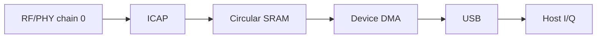

# BirriaSDR

Turn a supported USB Wi-Fi dongle into an experimental SDR receiver with
**14-bit I/Q at 40 MSps complex**.

This repository has two independent ways to use the hardware:

- **[Proof of concept](#proof-of-concept-cyberether-flowgraph)**: a
  self-contained CyberEther flowgraph with a Python receiver, gain controls and
  a spectrum/waterfall. Nothing to compile.
- **[C library](#c-library)**: a small C11 library, `libbirriasdr`,
  with a librtlsdr-style API, plus a command-line recorder.

> [!IMPORTANT]
>
> This is experimental software. Only one board and one receive profile are
> qualified, and frequency and gain are uncalibrated. Use at your own risk.

https://github.com/user-attachments/assets/64e9fbbd-1f16-4c7b-905c-5624b9c574b7

## Background

Wi-Fi chipsets contain a complete wideband receiver: an analog front end that
tunes, filters and amplifies the antenna signal, followed by a digital physical
layer that works on complex baseband samples. MediaTek parts also include an
internal I/Q capture engine (ICAP) intended for calibration and debugging.
BirriaSDR repurposes that path to stream raw samples to the host over USB.



The host configures the RF front end and capture engine directly through
registers. The capture engine writes samples into internal memory, and an
original 1,120-byte device program, loaded through the chip's immutable boot
ROM, submits that memory to USB DMA. The host verifies the stream and delivers
I/Q to the application.

No MediaTek RAM firmware or ROM patch is downloaded, and nothing is written to
flash or eFuse; all configuration is volatile. The device program's assembly
source is in [`firmware/iq_stream.S`](firmware/iq_stream.S) and is embedded in
both the flowgraph and the library.

The tested hardware is the **COMFAST MT7961/MT7921AU dongle (`3574:6211`)**,
an MT7961 digital die paired with an MT7972 analog die. The current profile is
channel 6 (nominal 2437 MHz), receive chain 0, at 40 million complex samples per
second. That rate represents a 40 MHz sampled span, but the analog receive
filter currently uses a **20 MHz profile** and rolls off; this is not a claim of
40 MHz flat usable bandwidth.

For more detail, see:

- [Receiver overview](docs/hardware.md)
- [MT7921 / MT7961 / MT7972 receiver](docs/mt7921.md), including the register reference
- [Architecture and adding a chipset](docs/architecture.md)

### Specifications

| Parameter | Current value |
| --- | --- |
| Hardware | COMFAST dongle `3574:6211`: MediaTek MT7961 digital die + MT7972 analog die |
| Frequency coverage | Fixed at 2437 MHz (Wi-Fi channel 6); other 2.4 GHz channels and 5 GHz not enabled yet |
| Sample rate | 40 MSps complex, fixed |
| Sampled bandwidth | 40 MHz span; analog filter uses a 20 MHz profile and rolls off inside it |
| Sample resolution | 14-bit signed I and Q, range −8192…8191 |
| Receive channels | One (chain 0) |
| Transmit | None; receive only |
| Gain | Raw codes: LNA 0–3, filter stage 0–8, digital 0–12; not calibrated in dB |
| Automatic gain | Overrides can be released; full AGC control not implemented |
| Frequency accuracy | Uncalibrated; no ppm correction |
| Reference clock | On-board 40 MHz crystal |
| Host interface | Bulk transfers over USB 3.0, about 161 MB/s |
| Output format | Interleaved signed 16-bit I,Q (`cs16`); the flowgraph emits CF32 |
| Firmware | Original 1,120-byte RAM program; no vendor firmware, nothing flashed |
| Host platforms | Linux (tested on Raspberry Pi 5) and macOS (not hardware-tested) |

## Proof of concept: CyberEther flowgraph

**[Download CyberEther](https://cyberether.org/) ·
[Installation guide](https://cyberether.org/docs/installation) ·
[Python setup](https://cyberether.org/docs/python-block#choosing-a-python-runtime) ·
[Flowgraph](cyberether/birriasdr-no-mediatek.yml)**

The flowgraph contains the RF-corrected Python receiver, gain controls and a
spectrum/waterfall. It is self-contained and does not require building the C
library or downloading MediaTek firmware.

1. Install the **CyberEther desktop app** with Python-block support and
   **Python 3.11+** on Linux or macOS.
2. Select that interpreter under **Settings → Runtime → Python Runtime** and
   restart CyberEther. Leave `PYTHON = None` in the receiver block so its USB
   worker uses the same interpreter.
3. Connect the **COMFAST MT7961/MT7921AU dongle (`3574:6211`)** through USB 3.0.
   Disconnect its Wi-Fi connection, stop other receivers using it and follow
   the [USB setup instructions](cyberether/README.md#usb-setup).
4. Open [birriasdr-no-mediatek.yml](cyberether/birriasdr-no-mediatek.yml) in
   CyberEther and allow its declared Python dependencies to install. The
   receiver starts feeding **Output 0** into the spectrum and waterfall.
5. To adjust gain, edit `GAIN_MODE`, `LNA_GAIN`, `LPF_GAIN` and `DIGITAL_GAIN`
   near the top of the Python block, then reload it. The
   [gain settings](cyberether/README.md#gain-controls) describe their ranges.
   Open the block's **Console** for errors; close the flowgraph to stop capture.

The single output carries all captured samples without averaging or decimation;
both display averaging settings are 1.

## C library

The `libbirriasdr` library follows the familiar enumerate → open → configure →
read → cancel → close pattern of
[librtlsdr](https://github.com/osmocom/rtl-sdr/blob/master/include/rtl-sdr.h).
It depends only on libusb and needs no Python runtime or MediaTek firmware
download.

### Build and try

Install a C compiler, CMake, and libusb development files. On Debian/Ubuntu:
`sudo apt install build-essential cmake pkg-config libusb-1.0-0-dev`.
On macOS with Homebrew: `brew install cmake pkg-config libusb`.

```sh
cmake -S . -B build -DCMAKE_BUILD_TYPE=Release
cmake --build build -j
ctest --test-dir build --output-on-failure
./build/birria_rx --list
./build/birria_rx capture.cs16 8000000 manual
```

The last command captures eight million complex samples on device 0, using
manual gain codes `(LNA=2, LPF=8, digital=0)`. Omit `manual` to release gain
overrides. Omit the sample count to record until Ctrl-C. The file contains
little-endian signed 16-bit **I, Q** pairs, each component in `[-8192,8191]`.
There is no averaging or decimation. Output files must not already exist.
Always check the exit status: an error means the capture is incomplete or its
continuity was not established, even if a file contains samples.

The dongle must start with **no vendor ROM patch loaded** and its Wi-Fi interface
available to libusb. A software reset does not remove a retained patch. On Linux,
prevent automatic Wi-Fi driver binding before reconnecting the dongle, and grant
USB access (or run the example with `sudo`). On macOS, reconnect first if another
driver previously loaded firmware. The library refuses an active kernel driver;
it never unloads drivers or power-cycles a USB hub.

### API

Include [`birriasdr.h`](include/birriasdr.h); it documents every function, units,
ownership, threading and error behavior. The
[recorder example](examples/birria_rx.c) is a complete application. The main
entry points are:

```c
birriasdr_get_device_count();
birriasdr_get_device_info(index, &info);
birriasdr_open(&dev, index);
birriasdr_set_center_freq(dev, 2437000000ULL);
birriasdr_set_sample_rate(dev, 40000000);
birriasdr_set_tuner_gain_mode(dev, 1);
birriasdr_set_gain_codes(dev, &gain);
birriasdr_read_async(dev, callback, context, 0, 0);
birriasdr_cancel_async(dev); /* From callback or another normal thread. */
birriasdr_close(dev);
```

This is an API outline; check every return value as the example does. Frequencies
use 64 bits so the API can represent future 5 GHz operation. Gain codes are
separate from the reserved calibrated-dB API.

The `read_async` function blocks its caller while a dedicated libusb event thread
keeps USB requests queued. Callbacks receive borrowed native-endian `int16_t` I,Q buffers,
complex-sample counts and a stream-relative sample index. Only `cancel_async`
may run concurrently on that handle. Setters are staged for the next read and
return busy during capture. Callbacks must return promptly; there is no silent
sample dropping when the device or host queue overflows.

The `read_sync` function captures a finite multiple of 2,048 complex samples
using the same USB engine. Separate read calls are separate acquisitions, not a gapless stream.
Both read paths verify framing, sequence, nonce, raw14 encoding, terminal state
and DMA counts; both reset on exit. Statistics include the last initialization
stage and any reset failure. Cancellation drains packets already submitted by
the device, so callbacks may continue until `read_async` returns.

### Install and link

```sh
cmake --install build --prefix /your/prefix
cc app.c $(pkg-config --cflags --libs birriasdr) -o app
```

Add your prefix's `lib/pkgconfig` (or platform-specific libdir) to
`PKG_CONFIG_PATH`. Shared builds are the default; use `-DBUILD_SHARED_LIBS=OFF`
for a static library and `pkg-config --static` when linking it.

### Source layout and firmware

Functions have comments above their definitions explaining their hardware role,
ordering requirements and unresolved assumptions. Register sequences are split
into clock, synthesizer, routing, gain, capture and boot operations. Unconditional
constant writes use small ordered tables; handshakes and timing stay explicit.

Normal builds use the checked-in original firmware header. To rebuild it, install
GNU binutils targeting NDS32 and run:

```sh
python3 tools/rebuild_firmware.py --check
```

Remove `--check` to replace the header after changing the assembly. The script
assembles `firmware/iq_stream.S`, links at `0x00915000`, then adds the PDA alignment
and checksum trailer. Python is needed only for this optional development step.
No vendor binary or ROM dump is an input.

## License

Original library, RF code, examples and firmware: **MIT.**
The USB/ROM transport adaptations retain **BSD-3-Clause-Clear** notices. See
[LICENSE](LICENSE), [NOTICE](NOTICE) and [the retained license](LICENSES/BSD-3-Clause-Clear.txt).
The software is provided without warranty; use at your own risk.

## Acknowledgements

BirriaSDR builds on open-source drivers and earlier research into using Wi-Fi hardware for raw I/Q capture. Thanks to:

- [Network Weather’s mt76-usb-macos](https://github.com/Network-Weather/mt76-usb-macos) — the Python userspace USB driver that provided the foundation for BirriaSDR’s device access and firmware loading.
- [mt76](https://github.com/openwrt/mt76) and its contributors — the upstream MediaTek driver implementation underlying that userspace work.
- [W1700K SDR](https://github.com/h0m3us3r/w1700k-sdr) by h0m3us3r — related work turning MediaTek Wi-Fi hardware into a wideband SDR, with useful documentation of capture registers and sample-clock controls.
- [MtkICAPtool](https://github.com/MtkWifiRev/MtkICAPtool) by MtkWifiRev — earlier work exposing MediaTek’s internal I/Q capture capabilities.

Third-party code retains its original licenses and copyright notices.
