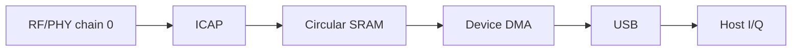

# BirriaSDR

> [!NOTE]
>
> **This is a research fork** of [luigifcruz/BirriaSDR](https://github.com/luigifcruz/BirriaSDR),
> based on upstream `cbe0575`. It was developed on an
> [EDUP EP-AX1672](https://www.szedup.com/usb-adaptersBr3/EP1672.html)
> (AX3000 Wi-Fi 6E, MediaTek MT7921AU, USB ID `0e8d:7961`) under WSL2 and adds,
> mostly as opt-in options:
>
> - a SoapySDR module (`-DBIRRIASDR_SOAPY=ON`, `driver=birriasdr`);
> - packet-detect suppression, which removes the exact-zero sample blanking;
> - chain 1 and both-chain capture, the post-filter channel tap, 20 and 80 MSps,
>   and a per-chain gain table in dB;
> - `birria_ble`, a streaming BLE advertising collector, and `birria_rx --recover`;
> - Python Wi-Fi and BLE decoders in [tools/decoders](tools/decoders/README.md).
>
> The measurements behind these, including what didn't work, are in
> [docs/findings.md](docs/findings.md). The adapter's USB 3 self-noise and the
> foil shield that removed most of it are covered under
> [antenna placement and shielding](#antenna-placement-and-shielding).
> Several of these additions overlap open
> upstream pull requests that take different approaches.
>
> Upstream's own testing, described below, is on a COMFAST `3574:6211` dongle
> with the same MT7961 and MT7972 dies. This fork's additions were tested only
> on the EP-AX1672; where this README or [docs/mt7921.md](docs/mt7921.md) says
> "the EDUP board", it means that adapter. The rest of this README is
> upstream's, updated for the additions.

Turn a supported USB Wi-Fi dongle into an experimental SDR receiver with
**14-bit I/Q at 40 MSps complex**.

BirriaSDR ships as `libbirriasdr`, a C11 library with an API modeled on
librtlsdr, together with a command-line recorder. It talks to the device from
userspace through libusb and includes the source of its own small device
program. Start with [Build and try](#build-and-try), or jump to the [API](#api)
to add the receiver to an application. To see it working without building
anything, try the rough [proof of concept](#proof-of-concept).

> [!IMPORTANT]
>
> This is experimental software. The tested board starts from a channel 6
> initialization profile, and the library tunes 2156 to 2610 MHz and 4500 to
> 6200 MHz. Sensitivity across those ranges, frequency accuracy and gain are not
> calibrated. Use at your own risk.

https://github.com/user-attachments/assets/64e9fbbd-1f16-4c7b-905c-5624b9c574b7

## Background

Wi-Fi chipsets contain a complete wideband receiver. An analog front end tunes,
filters and amplifies the antenna signal, and a digital physical layer then
processes the resulting complex baseband samples. Some chips also include an
internal I/Q capture engine (ICAP) meant for calibration and debugging.
BirriaSDR repurposes that capture path to stream raw samples to the host over
USB.



The host programs the radio front end and the capture engine directly through
their registers. The capture engine writes samples into the chip's internal
memory. A small original device program, only 1,664 bytes and loaded through the
chip's built-in boot ROM, sends that memory to the host over USB. The library
then checks the stream and hands complex samples to the application.

Nothing from the vendor is downloaded to the device, whether RAM firmware or a
ROM patch. Nothing is written to flash or eFuse either, so all configuration is
volatile and disappears when the dongle loses power. The device program's
assembly source lives in [`firmware/iq_stream.S`](firmware/iq_stream.S), and the
library embeds its assembled image.

Upstream's tested hardware is the **COMFAST MT7961/MT7921AU dongle
(`3574:6211`)**; this fork's additions were tested on an **EDUP EP-AX1672**
(`0e8d:7961`). Both pair an MT7961 digital die with an MT7972 analog die. By default the
receiver is centered on Wi-Fi channel 6 (nominally 2437 MHz) and uses receive
chain 0 at 40 million complex samples per second. The library can retune
anywhere in the 2156 to 2610 MHz and 4500 to 6200 MHz bands, even while
streaming and across bands. At 40 MSps it
pairs the **40 MHz analog filter with the matching digital bandwidth setting**
by default. Select `--bandwidth 20000000` to use the narrower analog/digital
profile for one Wi-Fi channel while keeping the same 40 MSps sample clock.
On the tested board, the measured noise spectrum falls about 3 dB at ±18 MHz.
The filters do not fully reject signals outside the sampled span, so strong
signals there can alias into the capture. Treat this as measured behavior
rather than a calibrated, flat bandwidth guarantee.

For more detail, see:

- The [receiver overview](docs/hardware.md)
- The [MT7921 / MT7961 / MT7972 receiver reference](docs/mt7921.md), with controls and register tables for each stage
- The [architecture guide](docs/architecture.md), which also covers adding a chipset

### Specifications

| Parameter | Current value |
| --- | --- |
| Hardware | COMFAST dongle `3574:6211`, or a board with MediaTek's generic ID `0e8d:7961`, with an MT7961 digital die and an MT7972 analog die |
| Frequency tuning | 2156 to 2610 MHz, or 2190 to 2610 MHz on generic-ID boards, and 4500 to 6200 MHz, including live changes and band switches. Sensitivity is unverified; 5 GHz reception was checked from 5250 to 5815 MHz |
| Tuning step | Nominally 28.61 Hz, using the full 20-bit fraction. Requests are in whole hertz with no Wi-Fi channel restriction. The physical response to fine steps is still unmeasured |
| Sample rate | 40 MSps complex capture. 20 MSps output is also available through a 2:1 halfband on the host (`--rate 20000000`), flat to ±8.5 MHz; USB traffic is unchanged. Experimental: 80 MSps (`--rate 80000000`), single chain and 2.4 GHz only, 320 MB/s over USB, with the BW80 filter profile. On the EDUP board over usbipd it gave flat-to-±30 MHz captures that decode channels 1–11 at once; 1 s finite captures usually succeed, and continuous reads see about one recovered gap every 20–30 s with the default 192 queued USB transfers. The sample clock and LO share one reference within 0.5 ppm (measured against Wi-Fi beacon timestamps), so 40 MSps is exact up to the crystal's tolerance |
| Receive filter profiles | Nominal 20 or 40 MHz, selected while idle. Both keep 40 MSps and the same USB traffic; default is 40 MHz. Opt-in `--channel-filter` captures after the PHY's digital channel filter, which follows the profile: at 20 MHz it lowered the floor 10–15 MHz off centre by about 13 dB. See [channel filter](docs/mt7921.md#channel-filter) |
| Sampled bandwidth | 40 MHz span with matching nominal 40 MHz analog and digital settings. See [filter characteristics](docs/mt7921.md#filtering) for rolloff and aliasing limits |
| Sample resolution | Signed 14-bit I and Q, from −8192 to 8191 |
| Receive channels | Chain 0 by default. Opt-in research setting (`--chain 1` or `--chain both`) for the second receiver alone or both chains interleaved. See [receive-chain selection](docs/mt7921.md#receive-chain-selection) |
| Transmit | None, receive only |
| Gain | Raw codes for LNA 0 to 5, filter stage 0 to 8 (0 to 15 for chain 0 at 5 GHz) and digital 0 to 12 on each streamed chain, or an overall gain from a measured table of relative dB (0 to 59.4 dB on chain 0 at 2437 MHz, 0 to 59.2 dB at 5 GHz). The tables were measured on the EDUP board and have no absolute dBm reference. At 5 GHz, weak signals need LNA 5 and a filter-stage code of 11 to 14, but strong APs clip at the top codes. See [gain in dB](docs/mt7921.md#gain-in-db) and [5 GHz filter-stage codes](docs/mt7921.md#5-ghz-filter-stage-codes) |
| Live gain changes | Supported without restarting capture, with a brief settling transient |
| Automatic gain | Manual overrides can be released. Full AGC control is not implemented |
| Capture blanking | The PHY packet detector blanks short zero runs into the capture. Opt-in packet-detect suppression (`--pd-n8`) removes them after about 250 ms of settling. Research setting, see [packet-detect suppression](docs/mt7921.md#packet-detect-suppression) |
| Frequency accuracy | Uncalibrated, with no ppm correction |
| Reference clock | On-board 40 MHz crystal |
| Host interface | Bulk transfers over USB 3.0 at about 161 MB/s |
| Output format | Interleaved signed 16-bit I and Q (`cs16`). Buffers from the API are native-endian, and recorder files are little-endian |
| Firmware | Original 1,664-byte RAM program. No vendor firmware and nothing flashed |
| Host platforms | Linux, tested on a Raspberry Pi 5, and macOS, tested on an Apple Silicon Mac |

### Antenna placement and shielding

On the EDUP board, the adapter's own USB 3 link was the largest noise source at
2.4 GHz. It couples into antenna A, the chain-0 port. Two changes helped, both
measured in [findings §4](docs/findings.md#4-antenna-placement-usb-3-self-noise-and-shielding):

- **Antenna A straight out.** Keep the stock antenna straight out from the
  side port, with no elbow bend and no pigtail. To aim it, turn the whole
  adapter. With the antenna bent alongside the adapter, the floor rose from
  about −50 to −42 dBFS, and blanking events rose from 3.5 to 11 per ms.
- **Shield the adapter.** The adapter body and the USB extension cable's
  connector were wrapped in kitchen aluminum foil, folded over for strength,
  and finished with copper tape. The shield is grounded to the USB connector
  shells and to the RP-SMA hex base, and the antennas stay outside it.

The same 28-capture scan was run before and after shielding. It used chain 0,
manual gain, plain 2 s captures and no register writes:

| Channel | Gain | Floor before | Floor after | Change |
| --- | --- | --- | --- | --- |
| 2.4 GHz ch 1 | LNA 3 | −44.3 dBFS | −48.0 dBFS | −3.7 dB |
| 2.4 GHz ch 6 | LNA 3 | −43.7 dBFS | −49.4 dBFS | −5.7 dB |
| 2.4 GHz ch 11 | LNA 3 | −42.6 dBFS | −49.6 dBFS | −7.0 dB |
| 5 GHz, 25 channels from 36 to 165 | LNA 5 | −52.0 to −52.6 dBFS | the same | median +0.02 dB |

At 2.4 GHz the shield removed most of the USB noise. The floor moved toward the
−53.7 dBFS measured with the antenna port open. At 5 GHz the floor was already
the receiver's own, so the shield had nothing to remove there. No narrowband
spur rose more than 3 dB over the median bin on any channel. Decoded frame
counts at 2.4 GHz follow traffic that changes from minute to minute, so they
don't measure the shield; the floors do. These numbers come from one run, on
one adapter, in one room.

## Proof of concept

**The [CyberEther](https://cyberether.org/) flowgraph in
[`cyberether/birriasdr.yml`](cyberether/birriasdr.yml) is a very rough proof of
concept.** It exists so people can quickly test the dongle and watch a live
spectrum without building anything. It runs its own Python receiver, separate
from the C library, with a fixed channel 6 profile, an older 20 MHz analog
filter and no automatic recovery. Expect rough edges and runs that stop on an
overrun. For anything beyond a quick test, use the C library.

To try it, install the CyberEther desktop app with a Python 3.11 or newer
runtime and select that interpreter under **Settings → Runtime → Python
Runtime**. Connect the dongle to a USB 3.0 port, open the flowgraph and let it
install its Python dependencies. The note inside the flowgraph explains the USB
setup for each platform and the gain settings. On a Raspberry Pi 5, the
flowgraph power-cycles the USB ports by default, which needs root and only works
when the dongle is the only USB device connected.

## Build and try

You need a C compiler, CMake and the libusb development files. On Debian or
Ubuntu, install them with
`sudo apt install build-essential cmake pkg-config libusb-1.0-0-dev`.
On macOS with Homebrew, run `brew install cmake pkg-config libusb`.

```sh
cmake -S . -B build -DCMAKE_BUILD_TYPE=Release
cmake --build build -j
ctest --test-dir build --output-on-failure
./build/birria_rx --list
./build/birria_rx capture.cs16 8000000 manual
```

The last command records eight million complex samples from device 0 with fixed
manual gain codes (LNA 2, filter stage 8, digital 0). Leave out `manual` to
release the gain overrides, and leave out the sample count to record until you
press Ctrl-C. The file holds little-endian signed 16-bit **I, Q** pairs, with
each component between −8192 and 8191. The recorder applies no averaging or
decimation, and it refuses to overwrite an existing file. Always check the exit
status. An error means the capture is incomplete or its continuity could not be
confirmed, even if the file contains samples.

To pick a different center frequency, pass it in hertz:

```sh
./build/birria_rx --frequency 2437123456 off-channel.cs16 8000000 manual
```

For Wi-Fi discovery, a narrower profile can reduce neighboring-channel energy:

```sh
./build/birria_rx --frequency 2462000000 --bandwidth 20000000 --gain 3 8 0 ch11.cs16 20000000
```

The `--gain LNA FILTER DIGITAL` option selects manual raw codes, including zero, with ranges
0 to 5, 0 to 8 (0 to 15 for chain 0 at 5 GHz) and 0 to 12. These are raw
indices, not dB values. At 5 GHz, `--gain 5 14 0` gave about 7 dB more SNR on
weak beacons than `--gain 5 8 0`. The narrower filter helped
decode additional AP beacons on the local EDUP MT7921AU board; this does not
qualify every supported board or guarantee a particular rejection response.

For finite recordings, `--buffered` acquires into RAM before converting and
writing the file, keeping disk I/O out of acquisition. Supply 2048–80,000,000
samples in multiples of 2048 (at most 320 MB / two seconds at 40 MSps).
Cancellation is checked after the bounded synchronous read. Failed acquisitions
are not written; a disk write failure still returns an error. This option does
not enlarge the device's SRAM ring or guarantee freedom from overruns.

For long streamed recordings, `--recover` keeps writing across gaps instead of
stopping at the first one:

```sh
./build/birria_rx --recover --frequency 2437000000 --gain 3 8 0 long.cs16
```

It enables the library's [automatic recovery](#automatic-recovery) with a
budget of 16 full restarts. Clean overruns don't spend it. Each gap is logged to
`long.cs16.gaps`, created next to the recording and also never overwritten. One
line per gap gives the file sample index where the gap falls, the library's
`next_sample`, the recovery attempt, the firmware state and the error. Samples
from that file index on follow a gap of unknown length, and nothing is inserted
to fill it. The log is flushed after every line. The exit status stays zero when
every gap was recovered, so check the log. Restarts reapply the settings, so
`--pd-n8` blanking can return while the detector settles again. The option
cannot be combined with `--buffered`, whose finite reads stay strict. At
40 MSps the file grows by about 160 MB/s, and by half that with
`--rate 20000000`.

On the EDUP board over usbipd (2026-10-25), 30 s at 40 MSps to disk and 11 s
at 20 MSps, stopped with Ctrl-C, recorded no gaps. Recording at 80 MSps is not gap-free:
about 0.9 gaps per second even into RAM, and up to 85 per
second once disk writeback throttled after about 20 s of a 30 s recording.
The recorder converts and writes in the read callback, so its I/O directly
slows the stream.

To suppress the PHY's packet-detect blanking (opt-in research setting, see
[packet-detect suppression](docs/mt7921.md#packet-detect-suppression)):

```sh
./build/birria_rx --buffered --frequency 2462000000 --bandwidth 20000000 --gain 3 8 0 --pd-n8 ch11.cs16 39999488 manual
```

`--pd-n8` discards the first 24,000,512 samples (about 600 ms, while the
detector settles) and still writes the requested count. With `--buffered`, the
requested count plus the discard must fit within 80,000,000 samples.
`--discard SAMPLES` sets the discard explicitly, in multiples of 2048 when
buffered, and also works without `--pd-n8`.

To isolate one Wi-Fi channel with the PHY's digital channel filter, and
optionally halve the output rate on the host:

```sh
./build/birria_rx --buffered --frequency 2462000000 --bandwidth 20000000 --channel-filter --gain 3 8 0 ch11.cs16 20000768 manual
./build/birria_rx --buffered --frequency 2462000000 --bandwidth 20000000 --channel-filter --rate 20000000 --gain 3 8 0 ch11_20m.cs16 10000384 manual
```

`--channel-filter` moves the capture to the channel-filtered tap. Use it with
the 20 MHz profile; at 40 MHz it only reduces aliasing. `--rate 20000000`
decimates 2:1 with a halfband filter that is flat to ±8.5 MHz and −6 dB at
±10 MHz. Counts and `--discard` are then output samples, the `--pd-n8` default
discard halves to 12,001,280, and the first 23 output samples of each
acquisition carry the filter's start transient. It cannot be combined with
`--chain both`.

To capture the second receiver (chain 1) instead, or both chains at once
(opt-in research setting, see
[receive-chain selection](docs/mt7921.md#receive-chain-selection)):

```sh
./build/birria_rx --buffered --frequency 2437000000 --bandwidth 20000000 --gain 3 8 0 --chain 1 wf1.cs16 8388608 manual
./build/birria_rx --buffered --frequency 2437000000 --bandwidth 20000000 --gain 3 8 0 --chain both both.cs16 16777216 manual
```

`--chain both` writes interleaved samples: even-numbered complex samples are
chain 0 and odd-numbered ones are chain 1, each at 40 MSps. Counts and
`--discard` are in interleaved samples and must be even, so the `--pd-n8`
default discard doubles to 48,001,024. Both-chain samples carry a DC offset per chain that the
library does not remove; subtract it before demodulating.

Before you start, the dongle must have **no vendor ROM patch loaded**, and its
Wi-Fi interface must be free for libusb to claim. A software reset does not
clear a patch that is already loaded. On Linux, stop the Wi-Fi driver from
binding automatically before you reconnect the dongle, and give your user USB
access with [`udev/60-birriasdr.rules`](udev/60-birriasdr.rules) (install
steps are in the file), or run the example with `sudo`. On macOS, reconnect the dongle first if
another driver loaded firmware onto it. The library refuses to run while a
kernel driver is attached, and it never unloads drivers or power-cycles a USB
hub.

### Bluetooth LE advertising collector

`birria_ble` demodulates LE 1M advertising as the samples arrive and keeps only
CRC-valid PDUs, so a run of any length stores a few hundred bytes per packet
instead of 160 MB/s of I/Q:

```sh
./build/birria_ble --pd-n8 --seconds 300 survey          # channels 37 + 38 at 2414 MHz
./build/birria_ble --input capture.cs16 --frequency 2437000000 offline
```

The default 2414 MHz / 40 MSps puts channel 37 (2402 MHz) and channel 38
(2426 MHz) 12 MHz either side of the center. No 40 MHz span holds all three
advertising channels. Advertisers send each event on all three, so two
channels see every advertiser. `--frequency 2453000000 --rate 80000000`
covers 38 + 39 at the experimental rate. Any channel at least 3 MHz inside
Nyquist is decoded; `--channels 37,38,39` restricts the list.

Each channel goes through a table mixer, an order-3 CIC-shaped FIR to 8 MSps
and a 48-tap 0.75 MHz FIR to 4 MSps. Then an FM discriminator and a per-phase
access-address correlator; the decision threshold follows the local mean
frequency, which absorbs carrier offset. A least-squares DC and amplitude fit
on the access address sets the slicer, then dewhitening and CRC-24. A failed
CRC is retried one sample early and one late. Nothing is corrected to fit the
CRC, and `--aa-errors` (default 1) bounds access-address bit errors.

Outputs, created next to each other and never overwritten:

- `survey.jsonl`: one line per valid PDU. Fields: time (Unix, or seconds from
  file start with `--input`), channel, uncalibrated dBFS power, SNR over a
  running noise floor, carrier offset, PDU type, TxAdd, first address, PDU hex.
- `survey.pcap`: the same packets as `LINKTYPE_BLUETOOTH_LE_LL_WITH_PHDR` for
  Wireshark (`--no-pcap` skips it).
- `survey.summary.json`: per-channel valid/failed/blanked counts, an
  advertiser table (packets per channel, first/last seen, best SNR, name,
  company ID), dropped samples, gaps, CPU seconds and peak RSS.

`decoders/ble_report.py survey.jsonl` expands the advertising data (names,
manufacturer data, service UUIDs) through `decoders/ble.py`'s parser.

Logging stops at `--max-bytes` (default 5,000,000,000, with 16 MiB kept for the
summary); counting continues. The USB callback only copies into a 40 MiB ring
(262 ms at 40 MSps), and a worker thread demodulates. If the worker ever falls
behind, whole blocks are dropped and counted rather than stalling USB. Gaps use
the library's [automatic recovery](#automatic-recovery) and reset the
demodulator. `--pd-n8` discards the first ~600 ms, as in `birria_rx`.

On a 1 s, 2437 MHz recording, channel 38 gave 37 CRC-valid PDUs, against 29
from `decoders/ble.py`. All 29 were among them. Offline, two channels took
0.32 s of CPU per second of 40 MSps input (Ryzen 5 7500F, WSL2) in 5.5 MB RSS.
Wireshark recomputed every CRC in the PCAP as correct.

Live on the EDUP board over usbipd (2026-10-26, `--pd-n8 --seconds 300`, AGC):
6,299 valid PDUs from 14 addresses in 300 s (channels 37 and 38: 3,048 and
3,251 valid; 212 and 197 failed CRC, 172 of the 409 with blanking inside). No
samples were dropped and there were no gaps. Output was 1.6 MB, with 91 MB peak
RSS, and 0.81 CPU-seconds per second (0.54 user, 0.27 system). The same stream
recorded by `birria_rx` took 0.55 CPU-seconds per second and 160 MB/s of disk,
so the demodulator adds about a third of a core.

## API

The library follows the familiar enumerate, open, configure, read, cancel and
close pattern of
[librtlsdr](https://github.com/osmocom/rtl-sdr/blob/master/include/rtl-sdr.h).
It does not need a Python runtime or any vendor firmware download.

The header [`birriasdr.h`](include/birriasdr.h) documents every function along
with its units, ownership, threading and error behavior. For a complete
application, see the [recorder example](examples/birria_rx.c). The main entry
points are:

```c
birriasdr_get_device_count();
birriasdr_get_device_info(index, &info);
birriasdr_open(&dev, index);
birriasdr_get_tuning_band(dev, 0, &minimum_hz, &maximum_hz);
birriasdr_set_center_freq(dev, 2437000000ULL);
birriasdr_set_sample_rate(dev, 40000000);
birriasdr_set_tuner_bandwidth(dev, 20000000); /* Optional nominal profile; idle only. */
birriasdr_set_packet_detect_suppression(dev, 1); /* Optional; discard ~600 ms. */
birriasdr_set_tuner_gain_mode(dev, 1);
birriasdr_set_gain_codes(dev, &gain);   /* Or birriasdr_set_tuner_gain(dev, 320) for 32.0 dB. */
birriasdr_read_async(dev, callback, context, 0, 0);
birriasdr_cancel_async(dev); /* From callback or another normal thread. */
birriasdr_close(dev);
```

This outline skips error handling, so check every return value as the example
does. Frequencies are 64-bit values. The 2.4 and 5 GHz bands are separate, so
`birriasdr_get_tuning_band` lists each contiguous band. The overall gain in
tenths of a dB picks the nearest step of `birriasdr_get_tuner_gains()`, and like
the raw codes it needs manual mode. Its scale is relative to the lowest code,
not an absolute RF gain.

The `read_async` function blocks the calling thread while a dedicated
background thread keeps USB transfers queued. Callbacks receive borrowed buffers
of native-endian `int16_t` I and Q values, the number of complex samples, and a
sample index counted from the start of the stream. While capture runs, another
thread can change the center frequency and raw gain, read them back, or call
`cancel_async`. When the device reports `BIRRIASDR_CAP_LIVE_TUNING` and
`BIRRIASDR_CAP_LIVE_GAIN`, those changes take effect without restarting capture.
A retune disturbs the signal phase. It took about 87 ms on the tested
Raspberry Pi, and about 54 ms over usbipd on Windows after the live RF-bridge
handshake was shortened (147 USB control transfers instead of 231). Samples
already queued may still come from the old center after the call returns, and
the library cannot report the exact sample where the change happened. All other settings can only change while the device is idle. See the
[tuning details](docs/mt7921.md#changing-frequency-during-capture) and
[gain details](docs/mt7921.md#changing-gain-during-capture). Callbacks must
return quickly. If the device or host queue overflows, the library reports an
error instead of silently dropping samples.

The `read_sync` function captures a fixed number of complex samples, in
multiples of 2,048, using the same USB engine. Separate calls produce separate
captures, not one continuous stream. Both read functions check every packet for
gaps, repeats, stale data and corruption, confirm the device's final state and
transfer counts, and reset the device when they finish. The statistics they
return record how far initialization got and whether the final reset failed.
Cancelling still delivers the packets the device has already sent, so callbacks
can keep arriving until `read_async` returns. Wait for the reading thread and
any control threads to finish before closing the handle.

### Automatic recovery

The library can restart streaming after an overrun, a transient transport error
or a failed live gain or frequency change. Register a gap callback before
reading:

```c
/* The on_gap callback receives a const struct birriasdr_recovery_event * and your context. */
int result = birriasdr_set_recovery(dev, 3, on_gap, context);
if (result == 0)
    result = birriasdr_read_async(dev, on_samples, context, 0, 0);
```

This budget permits up to three full restarts for device or transport faults.
Clean overruns do not consume it. The device can recover a source overrun by
restarting capture without reloading firmware or changing frequency and gain.
The host preserves completed USB transfers when its queue fills; this may
cause a device-side overrun, but it does not discard framing bytes.

Each gap notification precedes resumed samples. The event describes the failure,
includes diagnostics, and gives `next_sample`, the running count of delivered
samples at which the gap occurs. The library holds back one packet so an overrun
marker can discard potentially overwritten data before it reaches the application.
The number of lost samples is unknown. Reset processing that depends on
continuity; a successful return after recovery does not mean a gapless recording.

A full recovery reapplies the last frequency and gain that were set successfully. A
setter that fails still returns its error to its own caller. Cancelling
explicitly prevents any further restart. When the USB connection needs repair,
the library uses a software USB reset. It never switches hub power or downloads
vendor firmware. Device removal, a retained vendor patch and malformed stream
data are still reported as errors. If a reset invalidates the handle, close it
and find the device again.

Recovery stays off until you register a callback. Finite reads and the recorder
example stay strict and stop at the first error. Startup itself retries once
after a transient preparation failure, before any samples are captured. See the
[recovery mechanics](docs/mt7921.md#automatic-startup-and-stream-recovery).

## Run stability tests

The offline tests run with `ctest --test-dir build --output-on-failure`. To
exercise a connected dongle, run `./build/test_stability --run`. It checks
repeated starts and stops, tuning across the supported range, live gain and
frequency changes, and a five-minute stream. Set up the device as described
above, and see the [test scope](docs/architecture.md#tests-and-firmware). Run
individual phases with `--run restart`, `--run live` or `--run soak`.

A separate command, `./build/test_recovery --run`, deliberately causes overruns
and checks that a new capture works afterward, including after closing and
reopening the device. Add `auto` after `--run` to test gap notification and
automatic resumption. The `./build/test_control_recovery --run` command injects
failures into live gain and tuning writes, including failed rollbacks, and
checks that automatic recovery handles them.

## Install and link

```sh
cmake --install build --prefix /your/prefix
cc app.c $(pkg-config --cflags --libs birriasdr) -o app
```

Add your prefix's `lib/pkgconfig` directory (or the platform's equivalent
libdir) to `PKG_CONFIG_PATH`. Builds produce a shared library by default. For a
static library, configure with `-DBUILD_SHARED_LIBS=OFF` and link with
`pkg-config --static`.

## SoapySDR module

An optional [SoapySDR](https://github.com/pothosware/SoapySDR) module in
[`soapy/`](soapy/BirriaSDR.cpp) exposes the receiver as `driver=birriasdr`, so
gqrx, SDR++, GNU Radio (Soapy or osmocom sources) and other Soapy applications
can use it. It needs a C++17 compiler and the SoapySDR development files
(`sudo apt install libsoapysdr-dev soapysdr-tools` on Debian or Ubuntu,
`brew install soapysdr` on macOS):

```sh
cmake -S . -B build -DCMAKE_BUILD_TYPE=Release -DBIRRIASDR_SOAPY=ON
cmake --build build -j
sudo cmake --install build --prefix /usr/local
SoapySDRUtil --probe=driver=birriasdr
```

Devices are listed as `BirriaSDR <board name>`. The USB location (`usb=bus:address`) is
added to the label only when several identical boards are connected, because it
changes on every replug and applications save settings by label.

The module installs into `<libdir>/SoapySDR/modules<ABI>` under the prefix.
SoapySDR searches its own prefix and, when that is `/usr`, also `/usr/local`.
For a build-tree or other prefix, point `SOAPY_SDR_PLUGIN_PATH` at the module's
directory.

| Soapy control | Mapping |
| --- | --- |
| Channels | RX 0 is chain 0. With chain selection, RX 1 is chain 1, and a stream on channels `{0, 1}` captures both chains, deinterleaved into one buffer per channel. Chain 1 and both chains are research settings, as above |
| Formats | Native `CS16` with full scale 8192, or `CF32` scaled to ±1 |
| Sample rate | 40 MSps, or 20 MSps through the library's 2:1 halfband (flat to ±8.5 MHz). 20 MSps is single-chain only. Experimental 80 MSps, single chain; `getBandwidth` then reports the 80 MHz profile |
| Frequency | One `RF` component, retuned live, including across bands. `getFrequencyRange` lists each band separately (2156 or 2190 to 2610 MHz, and 4500 to 6200 MHz on MT7921). A request outside every band, including the gap between them, is logged and leaves the tuner where it was. 80 MSps is refused at 5 GHz |
| Bandwidth | 20 or 40 MHz, rounded to the nearer one. A change during a stream applies at the next stream start |
| Gain mode | Automatic releases the manual overrides; manual applies the cached codes |
| Gain elements | `LNA` 0 to 5, `LPF` 0 to 8 (0 to 15 for chain 0 at 5 GHz, following the tuned band) and `DIG` 0 to 12. These are raw indices, even where an application labels them dB. Codes set in automatic mode are kept for the next manual mode |
| Overall gain | The library's measured relative dB table, from 0 to 59.4 dB on chain 0 (0 to 59.2 dB at 5 GHz). A value picks the nearest step's codes, and a value set in automatic mode applies at the next manual mode |
| Antenna | `RX` only |
| Settings | `packet_detect_suppression` (applies at the next stream start; discard about the first 250 ms), `channel_filter` (capture after the digital channel filter; applies at the next stream start) and `max_restarts` (recovery budget, default 16) |
| Timestamps | `readStream` sets `SOAPY_SDR_HAS_TIME`. `timeNs` counts samples since activation at the nominal rate; across a gap it adds the lost interval measured on the host clock (about 1 ms uncertainty). It labels samples; it is not a hardware clock |
| Stream arguments | `bufflen` (complex samples per USB buffer, default 65536), `buffers` (host ring depth, default 64) and `transfers` (queued USB transfers, default 192, or 256 on macOS; on Linux the total must fit usbcore's `usbfs_memory_mb`, 16 MB by default) |

The module uses automatic recovery. Each source gap, recovered fault or buffer
dropped because the application fell behind is reported once, as
`SOAPY_SDR_OVERFLOW`, at the point where continuity was lost. Because some
applications ignore that code, the module also logs a warning at most once per
second while losses occur, for example
`BirriaSDR: last 1.0 s: 1 device gap (lost before reaching the host)` or
`BirriaSDR: last 1.0 s: 3 buffers (196608 samples) dropped because the application fell behind`,
and once more when the stream stops. Only one stream can be open per device.

Test scripts in [`soapy/tests/`](soapy/tests) check sustained rate and
timestamps (`soapy_rate_test.py`), live retuning (`soapy_tune_test.py`) and the
gr-osmosdr path that gqrx uses (`osmosdr_test.py`). They need the SoapySDR
Python bindings, NumPy and, for the last one, GNU Radio with gr-osmosdr
(`sudo apt install python3-soapysdr python3-numpy gr-osmosdr` on Debian or
Ubuntu). In gqrx, choose "Other..." and enter `soapy=0,driver=birriasdr`.
GNU Radio 3.10's own Soapy block applies `write_setting` normally, but its
Python `read_setting` always returns the declared default without asking the
device.

At 80 MSps, GNU Radio's default buffers between blocks are too small. A
gr-osmosdr source then delivers only 69–73 MS/s, and the module reports
buffers "dropped because the application fell behind". Giving the source a
larger output buffer fixes it: `src.set_min_output_buffer(1 << 20)` sustained
the full rate with no drops (`osmosdr_test.py --min-buffer 1048576`). GNU
Radio's own `soapy.source` kept up with default buffers. gqrx builds its own
flowgraph on gr-osmosdr, so expect drops there at 80 MSps; 40 MSps is the
practical gqrx rate.

Setters such as frequency, gain, bandwidth, antenna and sample rate log errors
through the SoapySDR logger instead of throwing, because some applications,
SDR++ among them, call them without catching exceptions. Opening the device and
setting up the stream still throw on failure.

If an application exits while a stream is running without stopping it (SDR++
does this when its window is closed), the module stops the stream during normal
process exit, so the library still restores the gain registers before its
reset. A killed or crashed application skips that cleanup. If manual gain was
in use, the next start then fails at the gain stage with "unexpected hardware
or receiver state"; unplug and reconnect the dongle to clear it.

## Source layout and firmware

Each function has a comment above its definition explaining its hardware role,
ordering requirements and any unresolved assumptions. Register sequences are
split into clock, synthesizer, routing, gain, capture and boot operations. Fixed
writes that always happen live in small ordered tables, while handshakes and
timing stay explicit in code.

Normal builds use the checked-in firmware header, which comes from the original
assembly. To rebuild it, install Python 3.10 or newer and GNU binutils targeting
NDS32, then run:

```sh
python3 tools/rebuild_firmware.py --check
```

Remove `--check` to replace the header after changing the assembly. The script
assembles `firmware/iq_stream.S`, links it at address `0x00915000`, and appends
the alignment padding and checksum that the boot ROM expects. Python is only
needed for this optional development step, and no vendor binary or ROM dump is
used as input.

## License

The original library, RF code, examples and firmware are licensed under
**MIT**. The adapted USB and ROM transport code keeps its
**BSD-3-Clause-Clear** notices. See [LICENSE](LICENSE), [NOTICE](NOTICE) and
[the retained license](LICENSES/BSD-3-Clause-Clear.txt). The software comes
without warranty, so use it at your own risk.

## Acknowledgements

BirriaSDR builds on open-source drivers and earlier research into using Wi-Fi hardware for raw I/Q capture. Thanks to:

- The [mt76-usb-macos](https://github.com/Network-Weather/mt76-usb-macos) Python userspace USB driver by Network Weather, which laid the foundation for BirriaSDR’s device access and firmware loading.
- The upstream [mt76](https://github.com/openwrt/mt76) Linux driver and its contributors, which the userspace work builds on.
- The [W1700K SDR](https://github.com/h0m3us3r/w1700k-sdr) project by h0m3us3r, related work that turns Wi-Fi hardware into a wideband SDR and documents capture registers and sample-clock controls.
- The [MtkICAPtool](https://github.com/MtkWifiRev/MtkICAPtool) project by MtkWifiRev, earlier work that exposed the chipset’s internal I/Q capture capabilities.
- The [Mtk79ICAP](https://github.com/MtkWifiRev/Mtk79ICAP) project by MtkWifiRev, whose vendor-firmware MT7921 work supplied the BW80 recipe, gain-hold layout and tap interpretation this fork re-implements, and the Soapy test scripts it adapts.

Third-party code keeps its original licenses and copyright notices.
